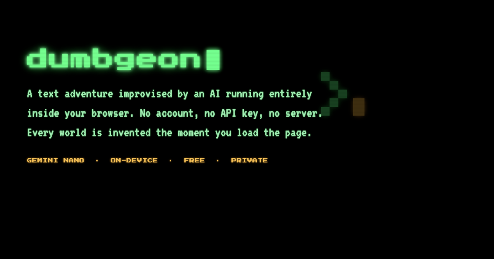

# dumbgeon

**A free AI text adventure that runs entirely inside your browser.**

[Play it →](https://eeman1113.github.io/dumbgeon/)

No account. No API key. No server. The language model runs on *your* machine
through Chrome's built-in Gemini Nano, so the game costs nothing, works offline
once the model is cached, and never sends a word of your story anywhere.



---

## What makes it different

Most AI text adventures drift. You type things, prose comes back, nothing is ever
at stake, and after ten turns the story is a pleasant fog. That happens because the
model is asked to *judge* — is this impossible? what's unresolved? how much damage? —
which is exactly what a small model is worst at.

dumbgeon inverts that. **Every judgement is made in deterministic TypeScript; the
model only writes sentences.**

- **A story director** walks a beat machine — `SETUP → BITE → COMPLICATE → REVERSE →
  SQUEEZE → CONFRONT → PAYOFF → BREATH` — with a rising tension floor, and injects one
  imperative directive into each turn naming the event that beat must deliver.
- **Real stakes.** A seeded roll decides success, partial success, cost or failure
  *before* the model writes anything. Naming an item you're carrying improves your
  odds, so inventory is leverage rather than decoration.
- **A drawn antagonist and a ticking clock**, composed from tables rather than
  generated — always coherent, zero model time.
- **Scheduled reveals.** Each world has a hidden truth. Handed to the model every
  turn it either leaks immediately or is ignored, so the director releases it once,
  on the `REVERSE` beat.
- **A chronicle** built from data the game already collects, carrying ~20 turns of
  continuity in less prompt space than two turns of verbatim prose.

All of it costs **zero extra model calls**.

## Requirements

- Desktop **Google Chrome 138+** with the built-in Gemini Nano model
- ~22 GB free disk, >4 GB video memory

If Chrome hasn't enabled it for you, the game tells you which flags to set
(`chrome://flags/#prompt-api-for-gemini-nano` and
`chrome://flags/#optimization-guide-on-device-model`).

## Running locally

```bash
npm install
npm run dev
```

Then open http://localhost:3000.

## Architecture

```
lib/director.ts   beat machine, action resolution, threats, clocks  (pure, testable)
lib/game.ts       prompts, world state, chronicle, delta parsing
lib/generate.ts   world generation from drawn constraints
lib/nano.ts       Chrome Prompt API wrapper + sampling fallback ladder
app/page.tsx      the turn loop
```

`lib/director.ts` has no browser or model dependencies, so you can simulate
hundreds of games in milliseconds to tune pacing.

## Tech

Next.js (static export) · TypeScript · Chrome Prompt API (Gemini Nano) · Lucide icons

## Licence

MIT
